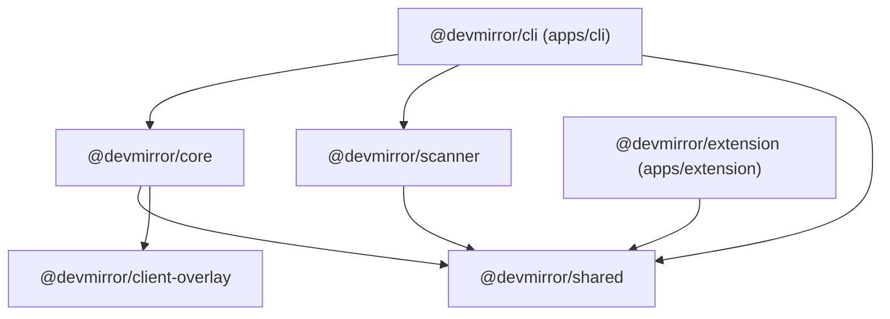

# DevMirror: Architecture & Monorepo Specification

**Document Status:** Approved Architecture Plan  
**Target Version:** v0.1.0 – v1.0.0  
**Author:** DevMirror Architecture & Developer Tools Engineering Team  

---

## 1. Monorepo Structure & Package Hierarchy

DevMirror is organized as a high-performance `pnpm` workspace monorepo. It enforces strict separation of concerns between core proxy primitives, detection engines, injected client runtimes, the CLI application, and the Chrome Extension.

```
devmirror/
├── package.json                   # Root package.json (pnpm workspaces, turbo scripts)
├── pnpm-workspace.yaml            # Workspace package declarations
├── tsconfig.base.json             # Shared strict TypeScript configuration
├── vitest.workspace.ts            # Monorepo-wide Vitest test configuration
├── .gitignore
├── .editorconfig
├── docs/                          # Architecture, security & research documentation
│   ├── RESEARCH.md
│   ├── SYSTEM_DESIGN.md
│   ├── ARCHITECTURE.md
│   ├── SECURITY.md
│   └── IMPLEMENTATION_ROADMAP.md
│
├── apps/
│   ├── cli/                       # DevMirror Terminal CLI & Agent Daemon
│   │   ├── src/
│   │   │   ├── commands/          # "start", "status", "scan", "tunnel"
│   │   │   ├── ui/                # Terminal UI (Ink / Chalk / ANSI QR display)
│   │   │   ├── index.ts           # CLI entry point (Commander.js)
│   │   │   └── server.ts          # Agent bootstrap combining proxy & control API
│   │   ├── package.json
│   │   ├── tsconfig.json
│   │   └── vite.config.ts         # Bundler config for single binary/dist build
│   │
│   └── extension/                 # Chrome Extension (Manifest V3)
│       ├── manifest.json          # MV3 configuration
│       ├── src/
│       │   ├── background/        # Service worker (active tab scanner, local IPC)
│       │   ├── popup/             # React + Tailwind popup UI (QR canvas, controls)
│       │   └── content/           # Content script (optional devtools hook)
│       ├── package.json
│       ├── tsconfig.json
│       ├── vite.config.ts         # Extension bundler (CRX / Vite plugin)
│       └── tailwind.config.js
│
└── packages/
    ├── core/                      # Core Reverse Proxy, Session & HMR Engine
    │   ├── src/
    │   │   ├── proxy/             # Fastify HTTP & WebSocket reverse proxy
    │   │   ├── hmr/               # Framework adapters (Vite, Next, Angular)
    │   │   ├── injection/         # HTML parser & companion HUD injection stream
    │   │   ├── session/           # Cryptographic token generator & validator
    │   │   ├── network/           # LAN IPv4 interface resolver & diagnostics
    │   │   └── index.ts
    │   ├── package.json
    │   └── tsconfig.json
    │
    ├── scanner/                   # Port, Process & Framework Detection Engine
    │   ├── src/
    │   │   ├── ports/             # Concurrent TCP socket prober
    │   │   ├── process/           # OS process table inspection (PID & CWD)
    │   │   ├── fingerprint/       # HTTP signature analyzer (Vite/Next/Vue/Angular)
    │   │   └── index.ts
    │   ├── package.json
    │   └── tsconfig.json
    │
    ├── client-overlay/            # Zero-dependency Mobile Companion HUD
    │   ├── src/
    │   │   ├── hud.ts             # Floating collapsible UI widget
    │   │   ├── console.ts         # Console interceptor (log/warn/error HUD)
    │   │   ├── hmr-shim.ts        # Client-side WebSocket URL resolver
    │   │   └── index.ts
    │   ├── package.json           # Builds to standalone lightweight dist/companion.min.js (<12KB)
    │   ├── tsconfig.json
    │   └── vite.config.ts
    │
    └── shared/                    # Shared Types, Schemas & Protocol Constants
        ├── src/
        │   ├── types/             # Session, Config, Target, Device types
        │   ├── constants/         # Default ports (4000, 4100), paths, headers
        │   ├── ipc/               # Control API REST schemas & WS message types
        │   └── index.ts
        ├── package.json
        └── tsconfig.json
```

---

## 2. Monorepo Dependency Graph



- **Zero Circular Dependencies:** Strict leaf-to-root hierarchy.
- **`@devmirror/shared`:** Contains TypeScript interfaces, message schemas, and protocol constants. Has no runtime dependencies.
- **`@devmirror/client-overlay`:** Built as a standalone pre-bundled asset (`companion.min.js`) embedded into `@devmirror/core` at build time so the proxy can serve it without external file system lookups.

---

## 3. Core Module Responsibilities & TypeScript Interfaces

### 3.1 `@devmirror/shared`: Protocol & Domain Types

```typescript
// packages/shared/src/types/index.ts

export type SupportedFramework = 'vite' | 'nextjs' | 'angular' | 'vanilla' | 'unknown';

export interface TargetDevServer {
  host: string;            // e.g. "127.0.0.1"
  port: number;            // e.g. 5173
  framework: SupportedFramework;
  pid?: number;
  cwd?: string;
  command?: string;
  isHttps: boolean;
}

export interface SessionInfo {
  sessionId: string;
  token: string;
  createdAt: number;
  expiresAt: number;
  target: TargetDevServer;
  lanIp: string;
  proxyPort: number;
  mobileUrl: string;       // e.g. "http://192.168.1.45:4000/?dm_token=..."
  connectedClients: ConnectedClient[];
}

export interface ConnectedClient {
  id: string;
  ip: string;
  userAgent: string;
  deviceType: 'ios' | 'android' | 'desktop' | 'unknown';
  connectedAt: number;
  lastPingAt: number;
}

export interface ControlApiMessage<T = unknown> {
  type: 'TARGET_CHANGED' | 'CLIENT_CONNECTED' | 'CLIENT_DISCONNECTED' | 'ERROR' | 'LOG';
  payload: T;
  timestamp: number;
}
```

### 3.2 `@devmirror/scanner`: Detection Engine

```typescript
// packages/scanner/src/index.ts

export interface IPortScanner {
  scanCommonPorts(customPorts?: number[]): Promise<number[]>;
  isPortListening(port: number, host?: string): Promise<boolean>;
}

export interface IProcessInspector {
  findDevServersInCwd(cwd: string): Promise<TargetDevServer[]>;
  findProcessByPort(port: number): Promise<{ pid: number; command: string } | null>;
}

export interface IFingerprinter {
  identifyFramework(host: string, port: number): Promise<{
    framework: SupportedFramework;
    isHttps: boolean;
    title?: string;
  }>;
}

export interface IDetectorEngine {
  detectActiveDevServer(options?: {
    preferredPort?: number;
    cwd?: string;
  }): Promise<TargetDevServer | null>;
}
```

### 3.3 `@devmirror/core`: Proxy & Session Engine

```typescript
// packages/core/src/proxy/index.ts

import type { TargetDevServer, SessionInfo } from '@devmirror/shared';

export interface ProxyOptions {
  lanIp: string;
  proxyPort: number;
  controlPort: number;
  target: TargetDevServer;
  sessionManager: ISessionManager;
  enableOverlay?: boolean;
}

export interface IProxyEngine {
  start(): Promise<{ proxyUrl: string; controlUrl: string }>;
  stop(): Promise<void>;
  updateTarget(newTarget: TargetDevServer): void;
  getActiveSession(): SessionInfo;
}

export interface ISessionManager {
  createSession(target: TargetDevServer, lanIp: string, proxyPort: number): SessionInfo;
  validateToken(token: string): boolean;
  validateCookie(cookie: string): boolean;
  registerClient(ip: string, userAgent: string): string;
  removeClient(clientId: string): void;
  revokeAllSessions(): void;
}

export interface IHmrAdapter {
  framework: SupportedFramework;
  rewriteHeaders(headers: Record<string, string | string[] | undefined>, target: TargetDevServer): Record<string, string>;
  shouldInterceptWebSocket(urlPath: string): boolean;
  transformHtmlResponse(html: string, session: SessionInfo): string;
}
```

---

## 4. Extensibility Design: Future Remote Tunnel Adapter

DevMirror is built with a pluggable transport architecture. While initial releases prioritize zero-latency local Wi-Fi connectivity, the proxy layer is fully decoupled from the network transport via the `ITunnelProvider` interface:

```
+-----------------------------------------------------------------------------------+
|                        PLUGGABLE TRANSPORT ARCHITECTURE                           |
+-----------------------------------------------------------------------------------+
                                Fastify Proxy Core
                                        |
                 +----------------------+----------------------+
                 |                                             |
                 v                                             v
     +-----------------------+                     +-----------------------+
     |   LocalLANTransport   |                     |   ITunnelProvider     |
     |  (Default Wi-Fi LAN)  |                     |   (Remote Fallback)   |
     |  - Direct TCP/HTTP    |                     |   - Cloudflare Tunnel |
     |  - Sub-3ms latency    |                     |   - WebRTC P2P Data   |
     |  - Bound to 0.0.0.0   |                     |   - Custom Relay      |
     +-----------------------+                     +-----------------------+
```

### 4.1 `ITunnelProvider` Specification

```typescript
// packages/core/src/tunnel/types.ts

export interface TunnelEndpoint {
  id: string;
  publicUrl: string;       // e.g. "https://dm-tunnel-xyz.devmirror.dev"
  secureToken: string;
  isP2P: boolean;          // true if WebRTC peer-to-peer data channel
  latencyMs?: number;
}

export interface ITunnelProvider {
  readonly name: string;
  readonly isAvailable: boolean;

  /**
   * Connects local Fastify proxy port to remote tunnel endpoint.
   */
  openTunnel(localPort: number): Promise<TunnelEndpoint>;

  /**
   * Closes the active remote tunnel.
   */
  closeTunnel(): Promise<void>;

  /**
   * Event emitter for tunnel connection lifecycle.
   */
  onStatusChange(callback: (status: 'connecting' | 'connected' | 'disconnected' | 'error') => void): void;
}
```

This design guarantees that when Cloudflare Tunnel, WebRTC, or Tailscale support is introduced, **zero changes** are required to the HMR adapters, Fastify proxy core, or Chrome Extension.

---

## 5. Control API & Chrome Extension IPC Specification

The Local Agent exposes a lightweight REST and WebSocket IPC server on `http://127.0.0.1:4100` strictly bound to the loopback interface.

| Endpoint | Method | Description | Request / Response Payload |
| :--- | :--- | :--- | :--- |
| `/api/health` | `GET` | Healthcheck and agent running status | `{ "status": "ok", "version": "0.1.0" }` |
| `/api/session` | `GET` | Returns active session, target, and QR data | `SessionInfo` JSON |
| `/api/target` | `POST` | Updates proxy target port (e.g. from Extension tab) | `{ "port": 3000, "framework": "nextjs" }` -> `SessionInfo` |
| `/api/session/revoke` | `POST` | Revokes current tokens and disconnects clients | `{ "revoked": true }` |
| `/api/clients` | `GET` | Returns list of currently connected mobile devices | `ConnectedClient[]` |
| `/api/events` | `WS` | Real-time bidirectional event feed for Chrome Extension | Stream of `ControlApiMessage` |

---

## 6. Testing & Quality Assurance Strategy

To ensure rock-solid stability across varying operating systems (Windows, macOS, Linux) and target bundlers, DevMirror employs a multi-tiered testing pipeline using **Vitest**:

```
+-----------------------------------------------------------------------------------+
|                            TESTING PYRAMID & SUITE                                |
+-----------------------------------------------------------------------------------+
|  E2E Bundler Integration  |  Real Vite/Next.js fixture servers + Playwright Mobile|
|  Duplex Proxy Streaming   |  Vitest HTTP & WS streaming benchmarks (<5ms overhead)|
|  Scanner & Fingerprinting |  Port probe, process match & signature tests          |
|  Unit Tests               |  Header rewriting, HTML injection, session crypto    |
+-----------------------------------------------------------------------------------+
```

### 6.1 Unit Test Coverage (`packages/core`, `packages/scanner`, `packages/shared`)
- **Crypto & Session:** 100% test coverage for token generation, CSPRNG entropy, constant-time token comparison, and cookie parsing.
- **Header Transformations:** Test matrix for Host, Origin, Referer, X-Forwarded headers across edge cases (IPv6, custom hostnames, trailing slashes).
- **HTML Rewriter Stream:** Test stream chunking, partial `<head>` tag splits across buffers, and decompression handling (gzip/brotli).

### 6.2 Bundler Integration Test Harness
The repo includes a dedicated `test/fixtures` directory with lightweight, headless sample apps:
- `fixtures/vite-react`: Basic Vite 5/6 React application.
- `fixtures/nextjs-app`: Minimal Next.js 14 App Router project.
- `fixtures/angular-app`: Minimal Angular 17 Vite-based project.
- `fixtures/vanilla-html`: Static HTML/CSS project.

Integration tests launch the fixture on an ephemeral port, start DevMirror proxy, simulate an incoming mobile HTTP request and WebSocket handshake, simulate a file change on disk, and assert that the HMR update payload is received on the mock mobile WebSocket client within 100ms.
