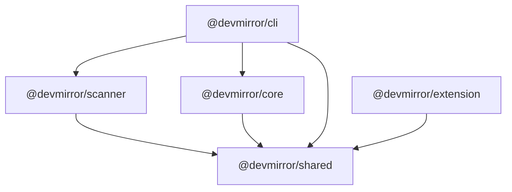
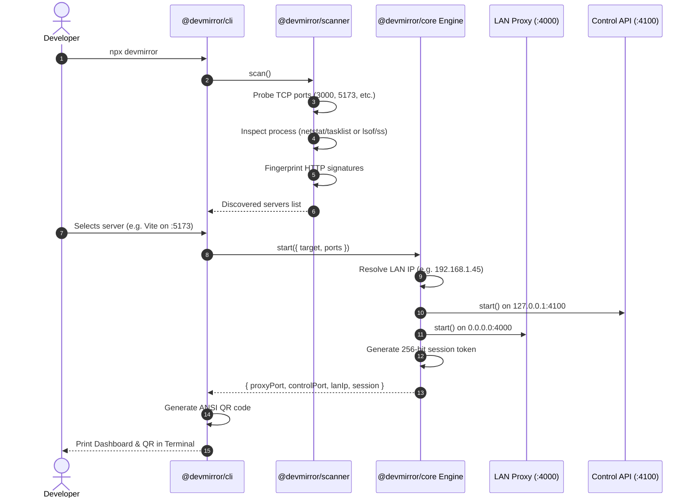
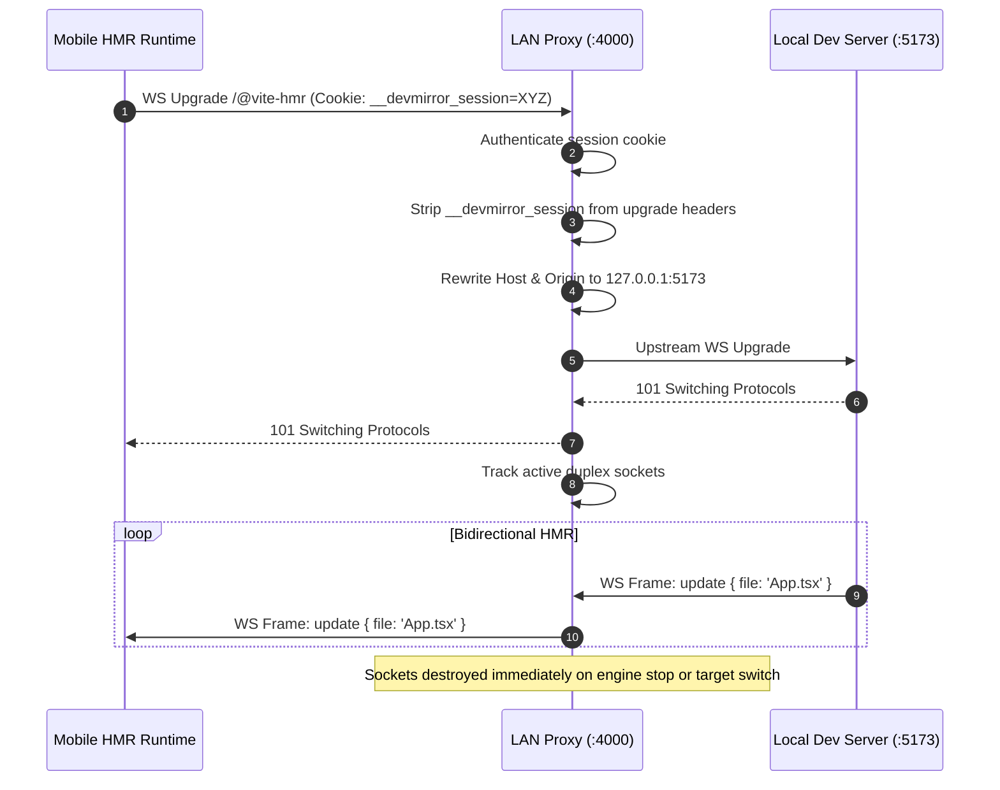

# DevMirror Architecture & System Specification

**Document Version:** 1.0.0 (Production Release)  
**Status:** Approved Architecture Implementation  
**Monorepo Path:** `D:\code\DevMirror`  

---

## 1. Monorepo Package Topology

DevMirror is organized as a high-performance `pnpm` workspace with strict package boundaries:

```text
devmirror/
├── packages/
│   ├── shared/                # @devmirror/shared: Protocol constants, types, schemas, token utilities
│   ├── core/                  # @devmirror/core: LAN proxy, HMR adapters, rewriter, session manager, Control API
│   ├── scanner/               # @devmirror/scanner: TCP prober, OS process inspector, framework fingerprinting
│   └── cli/                   # @devmirror/cli: CLI binary, ANSI QR generator, server selector, runner
├── apps/
│   └── extension/             # @devmirror/extension: Chrome Extension (Manifest V3) popup dashboard
└── docs/                      # Technical specifications, threat models, research notes
```

### Package Dependency Graph



---

## 2. Dual-Port Network Topology

DevMirror enforces strict interface segregation by separating the public LAN interface from the local control interface:

```
+-----------------------------------------------------------------------------------+
|                         NETWORK INTERFACE SEGREGATION                             |
+-----------------------------------------------------------------------------------+

     [ External LAN Interface ]                    [ Local Loopback Interface ]
        (e.g. 192.168.1.45)                                (127.0.0.1)
                 |                                              |
                 v                                              v
   +------------------------------+               +------------------------------+
   |   LAN Reverse Proxy Server   |               |   Local Fastify Control API  |
   |   Default: 0.0.0.0:4000      |               |   Default: 127.0.0.1:4100    |
   +------------------------------+               +------------------------------+
   | - Ephemeral token auth gate  |               | - Strictly bound to loopback |
   | - Upstream cookie stripping  |               | - Web origins forbidden      |
   | - HTML & HMR path rewriting  |               | - Extension & CLI IPC only   |
   | - Compression handling       |               | - Preflight mutating block   |
   +------------------------------+               +------------------------------+
                 |                                              |
                 +----------------------+-----------------------+
                                        |
                                        v
                         +-----------------------------+
                         |   Local Development Server  |
                         |   (e.g., 127.0.0.1:5173)    |
                         |   Vite / Next / Angular     |
                         +-----------------------------+
```

### 1. LAN Reverse Proxy (`0.0.0.0:4000`)
- **Binding:** Binds to `0.0.0.0` on the allocated proxy port (default: 4000, with automatic fallback up to 4100).
- **Authentication Gate:** Every incoming HTTP request and WebSocket upgrade must present either a valid `?dm_token=<token>` query parameter or a verified `__devmirror_session=<token>` cookie. Unauthenticated requests receive `401 Unauthorized`.
- **Address Bar Token Stripping:** Upon first authentication via query parameter, the server issues a `Set-Cookie: __devmirror_session=<token>; HttpOnly; SameSite=Lax` header and redirects to the clean URL, stripping the secret token from the browser address bar.
- **Upstream Cookie Isolation:** Before forwarding HTTP or WebSocket upgrade requests to the local dev server, the proxy strips the internal `__devmirror_session` cookie to prevent token leakage to application code.
- **HTML Streaming Rewriter:** Modifies HTML on the fly to rewrite framework HMR scripts and connection coordinates to point to the LAN proxy.

### 2. Local Control API (`127.0.0.1:4100`)
- **Binding:** Strictly bound to `127.0.0.1` (loopback only). Rejects external LAN connections at the TCP listener level.
- **Strict Origin Allowlist:** Verifies the `Origin` header using URL parsing. Rejects web origins (`http://localhost:*` or `http://127.0.0.1:*`) from mutating state (`POST`, `DELETE`, `PUT`, `PATCH`) and sensitive endpoints (`/api/v1/session/pairing-url`, `/api/v1/discover`, `/api/v1/devices`).
- **CORS Preflight Blocking:** In the wildcard `OPTIONS` handler, preflights for mutating methods from non-extension origins are terminated immediately with `403 Forbidden`.
- **Authorized Clients:**
  - **Chrome Extension:** Verified against the exact deterministic extension origin `chrome-extension://kmcaoghdokfdbadplofpkeabloldmoga` and must pass `x-devmirror-csrf: 1`.
  - **Terminal CLI:** Non-browser requests without an Origin header must explicitly pass `x-devmirror-cli: 1` or an auth token.

---

## 3. End-to-End Sequence Diagrams

### 3.1 CLI Startup & Server Discovery Flow



### 3.2 Mobile Pairing & Authentication Flow

```mermaid
sequenceDiagram
    autonumber
    actor Mobile as Mobile Browser
    participant Proxy as LAN Proxy (:4000)
    participant DevServer as Local Dev Server (:5173)

    Mobile->>Proxy: GET /?dm_token=XYZ (Camera Scan)
    Proxy->>Proxy: Validate token (timingSafeEqual)
    Proxy-->>Mobile: 302 Found (Set-Cookie: __devmirror_session=XYZ; Location: /)
    Note over Mobile: Address bar cleaned: token removed from URL!
    Mobile->>Proxy: GET / (Cookie: __devmirror_session=XYZ; appCookie=123)
    Proxy->>Proxy: Validate session cookie
    Proxy->>Proxy: Strip __devmirror_session from headers
    Proxy->>DevServer: Forward GET / (Cookie: appCookie=123)
    DevServer-->>Proxy: 200 OK (HTML Payload)
    Proxy->>Proxy: Rewrite HTML & inject HMR client configs
    Proxy-->>Mobile: 200 OK (Transformed HTML)
```

### 3.3 WebSocket HMR Proxying Flow



---

## 4. Cross-Platform Process Inspection Architecture

The `@devmirror/scanner` package identifies which local processes own listening ports using native OS tools without executing shell scripts:

```
+-----------------------------------------------------------------------------------+
|                        PROCESS INSPECTOR FACTORY                                  |
+-----------------------------------------------------------------------------------+
                                      |
                     [ os.platform() === 'win32'? ]
                                      |
                    +-----------------+-----------------+
                    |                                   |
                 ( Yes )                             ( No )
                    v                                   v
    +-------------------------------+   +-------------------------------+
    |    WindowsProcessInspector    |   |     PosixProcessInspector     |
    +-------------------------------+   +-------------------------------+
    | - netstat.exe -ano -p tcp     |   | 1. Try lsof -n -P -iTCP:<p>   |
    | - tasklist.exe /fi PID eq ... |   | 2. Fallback to ss -tlpn       |
    | - Strict PID numeric checks   |   | 3. Resolve name via ps comm=  |
    | - windowsHide: true           |   | - Argument arrays, timeouts   |
    +-------------------------------+   +-------------------------------+
```

---

## 5. Session Lifecycle & Target Switching

- **Single Active Session Model:** The engine enforces a single active session at any given time.
- **Dynamic Target Switching:** When a developer switches targets (via CLI or Chrome Extension `POST /api/v1/session`):
  1. The target dev server coordinates are updated.
  2. All existing client sockets and upstream WebSocket tunnels are cleanly closed.
  3. The HTML rewriter reconfigures its framework adapter for the new target.
  4. The pairing token remains valid or can be revoked via `DELETE /api/v1/session`.
- **Graceful Teardown:** Upon `SIGINT`/`SIGTERM` or pressing `q`:
  - Active sockets are destroyed immediately.
  - LAN proxy server closes all keep-alive connections (`server.closeAllConnections()`).
  - Fastify Control API closes gracefully (`app.close()`).
  - Port allocations are freed in `PortManager`.
  - TTY input streams are paused and restored.
