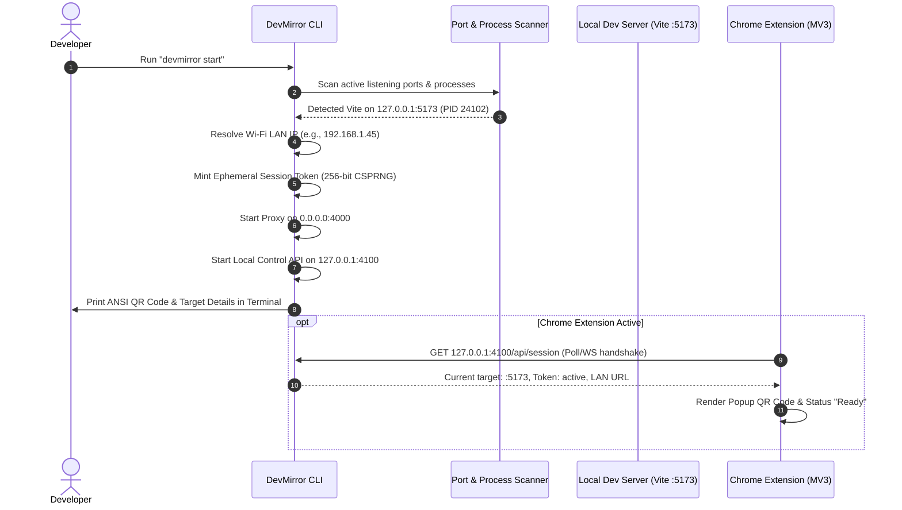
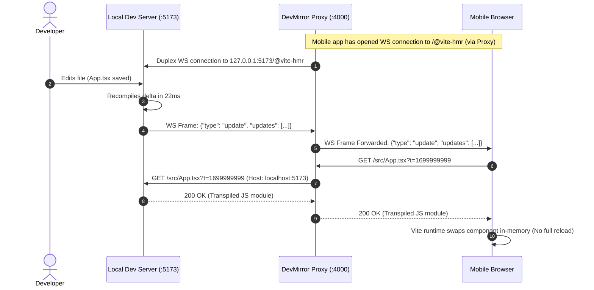

# DevMirror: System Design Document

**Document Status:** Approved Architecture Plan  
**Target Version:** v0.1.0 – v1.0.0  
**Author:** DevMirror Architecture & Developer Tools Engineering Team  

---

## 1. System Topology & Architectural Overview

DevMirror operates as a local-first, distributed developer tool comprised of four primary nodes communicating over local loopback (`127.0.0.1`) and Local Area Network (Wi-Fi LAN) interfaces.

```
+--------------------------------------------------------------------------------------------------+
|                                  DEVMIRROR ARCHITECTURE TOPOLOGY                                 |
+--------------------------------------------------------------------------------------------------+
                                     DEVELOPER WORKSTATION
  +---------------------------------------------------------------------------------------------+
  |                                                                                             |
  |  +-------------------------+                     +---------------------------------------+  |
  |  |  Target Local Dev Server|                     |      Chrome Extension (Manifest V3)   |  |
  |  |   (Vite, Next, Angular) |                     |  - Active tab port discovery          |  |
  |  |   http://127.0.0.1:5173 |                     |  - Popup UI with QR canvas            |  |
  |  +------------^------------+                     |  - Status & connected devices list    |  |
  |               |                                  +-------------------^-------------------+  |
  |               | Internal HTTP / WS                                   |                      |
  |               | (Duplex Proxying)                                    | Local Loopback IPC   |
  |               |                                                      | (HTTP/WS Port 4100)  |
  |  +------------v------------------------------------------------------v-------------------+  |
  |  |                           DEVMIRROR LOCAL AGENT (CLI / CORE)                          |  |
  |  |                                                                                       |  |
  |  |   [Port & Process Scanner]        [Authentication & Session Manager]                  |  |
  |  |   Discovers target dev server     Generates cryptographically secure ephemeral tokens |  |
  |  |                                                                                       |  |
  |  |   [Fastify Reverse Proxy Engine]  [HMR & HTML Adapter]                                |  |
  |  |   - HTTP Streaming Engine         - Host/Origin Header Rewriting                      |  |
  |  |   - WebSocket Duplex Router       - Injects Mobile Companion HUD & HMR shims          |  |
  |  |   - LAN Interface Resolver        - Content-Security-Policy Normalization             |  |
  |  +-------------------------------------------^-------------------------------------------+  |
  |                                              |                                              |
  +----------------------------------------------|----------------------------------------------+
                                                 |
                                                 | Wi-Fi LAN HTTP & WS
                                                 | (http://192.168.1.15:4000/?dm_token=...)
                                                 |
                                 +---------------v---------------+
                                 |         MOBILE DEVICE         |
                                 |    (Physical iPhone/Android)  |
                                 |                               |
                                 |   Mobile Browser (Safari/     |
                                 |   Chrome)                     |
                                 |   - Mirrored Web Application  |
                                 |   - Live HMR updates          |
                                 |   - Injected DevMirror HUD    |
                                 |     (Console, Network, Sync)  |
                                 +-------------------------------+
```

---

## 2. Core Subsystems & Responsibilities

### 2.1 DevMirror CLI & Local Agent
The core Node.js application runs as a background or foreground daemon launched via `npx devmirror` or `devmirror start`.
- **Network Interface Resolver:** Enumerates network interfaces (`os.networkInterfaces()`) to identify the active Wi-Fi LAN IPv4 address (e.g., `192.168.x.x`, `10.x.x.x`), filtering out Docker, loopback, and virtual VM interfaces.
- **Scanner Engine:** Scans local ports and OS process tables to identify the active dev server, its PID, and framework fingerprint.
- **Fastify Proxy Engine:** Serves two interfaces:
  1. **LAN Proxy Port (`4000` default):** Bound to `0.0.0.0` or the specific LAN IP. Routes HTTP requests and WebSocket streams to the target dev server while enforcing token-based authentication.
  2. **Loopback Control API (`4100` default):** Strictly bound to `127.0.0.1`. Serves REST/WebSocket endpoints consumed exclusively by the Chrome Extension and CLI commands.
- **Terminal UI (TUI):** Displays session status, connected device info, target proxy destination, and an ANSI QR code for quick scanning directly from the developer's terminal.

### 2.2 Chrome Extension (Manifest V3)
Designed for seamless integration into the developer's everyday browser workflow.
- **Background Service Worker:**
  - Pings the DevMirror Local Control API (`http://127.0.0.1:4100/health`).
  - Monitors active tab changes using `chrome.tabs.onActivated` and `chrome.tabs.onUpdated`.
  - When an active tab is on `http://localhost:*` or `http://127.0.0.1:*`, it extracts the port and posts it to the DevMirror agent to auto-target that project.
- **Extension Popup (React + Tailwind CSS):**
  - Renders a crisp SVG/Canvas QR code of the authenticated mobile URL.
  - Displays toggle controls: Framework override, Mobile HUD toggle, Manual port selector.
  - Shows connected mobile clients with "Disconnect / Revoke" action buttons.
  - Provides a 1-click "Copy URL" button.

### 2.3 Fastify Reverse Proxy Architecture
The proxy uses Fastify due to its low overhead, async architecture, built-in schema validation, and streaming performance.

```
+-----------------------------------------------------------------------------------+
|                         REVERSE PROXY REQUEST PIPELINE                            |
+-----------------------------------------------------------------------------------+
                               Mobile HTTP Request
                                       |
                                       v
                 +-------------------------------------------+
                 |       Session & Token Authenticator       |
                 | (Validates Cookie: dm_session or ?dm_token|
                 +---------------------|---------------------+
                                       | Valid
                                       v
                 +-------------------------------------------+
                 |          Header Transformation            |
                 | - Rewrite Host -> target:port             |
                 | - Rewrite Origin / Referer -> target      |
                 | - Inject X-Forwarded-For, X-Forwarded-Host|
                 +---------------------|---------------------+
                                       |
                                       v
                 +-------------------------------------------+
                 |       Upstream Dispatch (Target Server)   |
                 | Pipe request stream -> http://127.0.0.1:P  |
                 +---------------------|---------------------+
                                       |
                                       v
                 +-------------------------------------------+
                 |         Response Interceptor              |
                 | - Is response text/html?                  |
                 |   NO  --> Direct pipe back to mobile      |
                 |   YES --> Decompress (gzip/brotli)        |
                 |           Inject Mobile HUD & HMR Shim    |
                 |           Update Content-Length & CSP     |
                 |           Pipe back to mobile             |
                 +-------------------------------------------+
```

### 2.4 Mobile Client Companion (Injected HUD)
To improve the debugging experience on mobile without requiring USB debugging, DevMirror dynamically injects a tiny (under 12KB uncompressed, zero external dependencies) client script into the root HTML page:
- **Mobile Dev HUD:** Floating collapsible pill displaying:
  - Connection status indicator (Green = HMR Connected, Yellow = Reconnecting, Red = Offline).
  - Floating Console Drawer: Intercepts `console.log`, `console.error`, and `console.warn` so developers can see JavaScript errors directly on their phone screen.
  - Reload & Cache Bust button: One-tap hard refresh.
  - Ping latency counter.
- **HMR Polyfill Shim:** Ensures the framework's client bundle (e.g., Vite's `/@vite/client`) resolves WebSocket connections to DevMirror's proxy port rather than failing to reach `localhost`.

---

## 3. Communication Protocols & Sequence Diagrams

### 3.1 Startup & Target Discovery Flow



### 3.2 Mobile Pairing & Authentication Flow

```mermaid
sequenceDiagram
    autonumber
    actor Dev as Developer
    participant Mobile as Mobile Browser
    participant Proxy as DevMirror Proxy (:4000)
    participant SessionMgr as Session Manager
    participant Target as Local Dev Server (:5173)

    Dev->>Mobile: Scan QR Code (http://192.168.1.45:4000/?dm_token=xyz789)
    Mobile->>Proxy: GET /?dm_token=xyz789
    Proxy->>SessionMgr: Validate Token("xyz789")
    SessionMgr-->>Proxy: Valid (First-time device claim)
    SessionMgr->>SessionMgr: Bind session to Mobile User-Agent & Client ID
    Proxy-->>Mobile: Set-Cookie: dm_session=xyz789; HttpOnly; SameSite=Lax<br/>302 Redirect to "/" (Strip token from URL)

    Mobile->>Proxy: GET / (with Cookie: dm_session=xyz789)
    Proxy->>Target: GET / (Host: localhost:5173)
    Target-->>Proxy: 200 OK (HTML document)
    Proxy->>Proxy: Inject DevMirror Mobile Companion HUD script
    Proxy-->>Mobile: 200 OK (Rendered HTML + Companion HUD)
    Mobile->>Proxy: WS Upgrade /devmirror-companion-ws
    Proxy-->>Mobile: 101 Switching Protocols (HUD Connected)
```

### 3.3 Hot Module Replacement (HMR) Flow



---

## 4. Reverse Proxy Deep-Dive

### 4.1 Header Transformations
To guarantee that target frameworks treat the proxied connection as local and valid:

| Header Name | Inbound from Mobile | Outbound to Target Dev Server | Reason |
| :--- | :--- | :--- | :--- |
| `Host` | `192.168.1.45:4000` | `localhost:<TARGET_PORT>` | Satisfies Vite 6 / Webpack `allowedHosts` security check. |
| `Origin` | `http://192.168.1.45:4000` | `http://localhost:<TARGET_PORT>` | Prevents CORS and CSRF rejections by bundlers. |
| `Referer` | `http://192.168.1.45:4000/page` | `http://localhost:<TARGET_PORT>/page` | Ensures asset lookups and routing matches local origin. |
| `X-Forwarded-For` | Mobile LAN IP (`192.168.1.x`) | Mobile LAN IP | Preserves client tracking. |
| `X-Forwarded-Host`| `192.168.1.45:4000` | `192.168.1.45:4000` | Allows frameworks with reverse-proxy support to build correct asset URLs. |
| `X-Forwarded-Proto`| `http` | `http` | Preserves protocol identity. |

### 4.2 HTML Rewriting & Content Injection Engine
DevMirror parses and intercepts HTML responses before they reach the mobile client:
1. **Detection:** Checks response header `Content-Type: text/html`. Non-HTML assets (JS, CSS, images, JSON) are streamed directly with zero modification.
2. **Decompression:** If upstream response is compressed (`Content-Encoding: gzip`, `br`, or `deflate`), it is decompressed on the fly using Node.js `zlib`.
3. **Script Injection:** DevMirror injects two micro-scripts just before the closing `</head>` tag:
   ```html
   <!-- [DevMirror Injected Runtime] -->
   <script>
     window.__DEVMIRROR_CONFIG__ = {
       proxyPort: 4000,
       targetPort: 5173,
       sessionId: "xyz789",
       framework: "vite"
     };
   </script>
   <script src="/__devmirror/companion.js" defer></script>
   ```
4. **Header Recalculation:** `Content-Length` is recalculated, `Content-Encoding` is removed or recompressed, and `ETag` is invalidated to prevent stale client caching.
5. **Content-Security-Policy (CSP) Normalization:** If the dev server sends a strict CSP header or `<meta http-equiv="Content-Security-Policy">` that forbids inline scripts or WebSocket connections to `ws://*`, DevMirror patches the directive to permit `/__devmirror/*` and the proxy WebSocket origin.

### 4.3 WebSocket Duplex Routing Architecture
The proxy utilizes a dynamic WebSocket dispatcher:
- Listens for HTTP `Upgrade: websocket` events on the Fastify server.
- Matches request paths:
  - Path `/__devmirror/ws`: Routed to the internal DevMirror Companion Controller (for HUD logs, status, device control).
  - All other paths (`/@vite-hmr`, `/_next/webpack-hmr`, `/ng-cli-ws`, `/ws`): Routed to the target dev server on `127.0.0.1:<TARGET_PORT>`.
- Preserves all subprotocols (e.g., `vite-hmr`) and transmits binary or text frames without buffering delays.

---

## 5. Session & QR Token Authentication Design

Security on shared local networks (e.g., office Wi-Fi, coffee shops) is paramount. DevMirror implements a multi-layer authentication strategy to prevent unauthorized LAN peers from discovering or hijacking developer sessions.

```
+-----------------------------------------------------------------------------------+
|                        SESSION AUTHENTICATION LIFECYCLE                           |
+-----------------------------------------------------------------------------------+
1. Startup: Generate 256-bit CSPRNG token (Token A).
2. QR Code encodes: http://<LAN_IP>:<PROXY_PORT>/?dm_token=<Token_A>
3. Mobile scans QR Code -> Performs initial GET request with token.
4. Proxy validates Token A against memory store.
5. If valid:
   - Sets secure HTTP-only Cookie: dm_session=<Signed_Token>
   - Redirects (302) to "/" to strip query parameter from URL (prevents shoulder-surfing/history leak).
6. Subsequent requests authenticated via Cookie or Authorization header.
7. Optional "Pairing Guard" (CLI/Extension prompt):
   "Allow new connection from iPhone 15 (192.168.1.88)? [Y/n]"
```

- **Token Storage:** In-memory with an active session store. No database required.
- **Expiration:** Tokens expire automatically when the CLI process exits, or after 12 hours of inactivity.
- **Revocation:** Developer can click "Revoke All Sessions" in the Chrome Extension or press `r` in the CLI terminal to regenerate tokens instantly, kicking all connected devices.

---

## 6. Zero-Config Port Detection Engine

The detection subsystem uses a 3-tier cascade:

```
                  +----------------------------------+
                  |  Cascade Tier 1: Chrome Ext      |
                  |  Active Tab on localhost:PORT?   |
                  +-----------------+----------------+
                                    | No
                                    v
                  +----------------------------------+
                  |  Cascade Tier 2: Process & CWD   |
                  |  Node process running in CWD?    |
                  +-----------------+----------------+
                                    | No
                                    v
                  +----------------------------------+
                  |  Cascade Tier 3: Socket Prober   |
                  |  Probe Ports 3000, 5173, etc.    |
                  +-----------------+----------------+
                                    |
                                    v
                  +----------------------------------+
                  |  Resolve Target or Prompt Dev    |
                  +----------------------------------+
```

1. **Tier 1 (Browser Intent):** If the Chrome Extension is running, it reports what local tab the developer has open in Chrome right now. If the developer is actively editing and viewing `localhost:5173`, DevMirror selects `5173` with 100% confidence.
2. **Tier 2 (Process Inspection):** If CLI is run from a project directory (e.g., `/Users/dev/my-vite-app`), the scanner checks if any active Node process matches the CWD and inspects its open network sockets.
3. **Tier 3 (Heuristic Socket Scanner):** Scans the top 15 most common web dev ports concurrently using zero-payload TCP probes:
   - `5173` (Vite default)
   - `3000` (Next.js, CRA, Nuxt)
   - `8080` (Webpack, Vue CLI)
   - `4200` (Angular CLI)
   - `8000` (Django, Python, Astro)
   - `5000` (Serve, SvelteKit)
   - `4321` (Astro default)
   - `5500` (VS Code Live Server)
   - `1234` (Parcel)
4. **Resolution:** If exactly one active server is found, DevMirror auto-binds to it. If multiple are found, DevMirror displays an interactive terminal selector or accepts a CLI argument: `devmirror --port 3000`.
